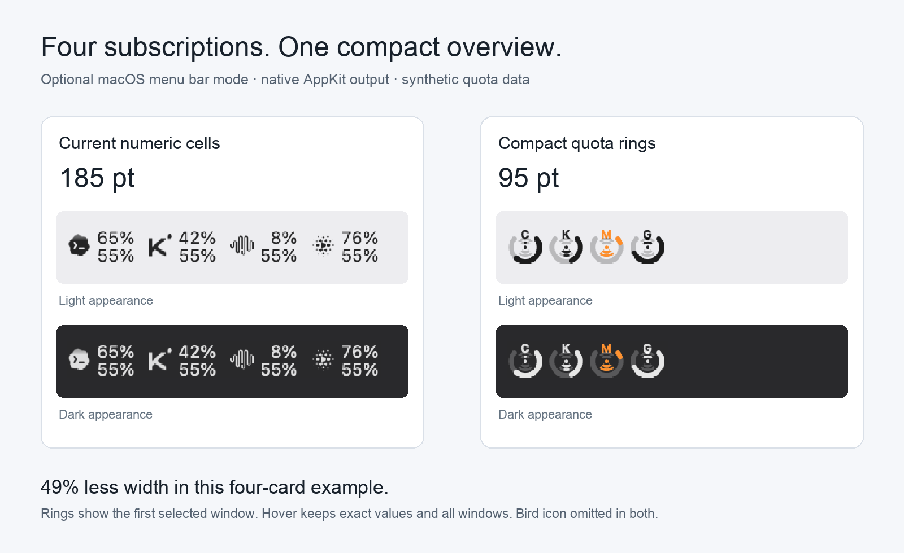
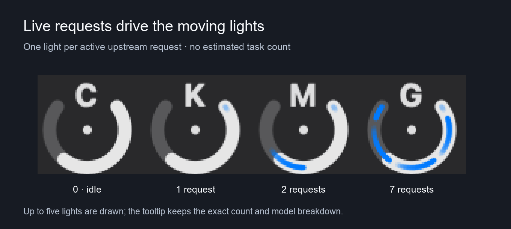

# Compact quota rings — native preview

An optional macOS menu-bar layout for Magpie users with several subscriptions.

The same four fixture subscriptions measure **185 pt as numeric cells** and **95 pt as rings**, excluding the bird icon in both: about **49% less width** in this example. Rings show the first selected quota window; all exact figures and other windows remain in the tooltip.

The four units demonstrate **idle, 1, 2, and 7 active upstream requests**. Drawing caps at five lights; the actual count and model breakdown stay in the tooltip. These are synthetic concurrency frames from the real AppKit renderer, not a recording of live accounts. The runtime source is Magpie's real in-flight request/route lifecycle, with actual fallback-account attribution. Whole agent tasks and tool-execution gaps are not inferred from request counts.

This layout has been used for a long time in AI Quota Bar; the Magpie port is new. Numeric mode remains the default. System/app Reduce Motion leaves stationary activity lights.

Implementation: [codex/compact-quota-rings](https://github.com/techfanseric/magpie/tree/codex/compact-quota-rings). This branch contains preview images only; it is separate from the reviewable source patch.
