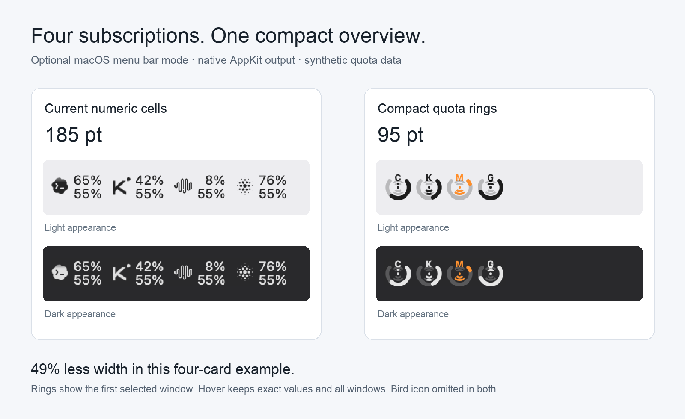
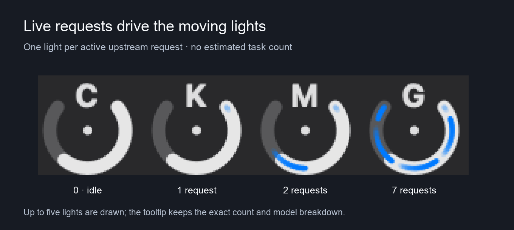

# Compact quota rings for multiple subscriptions

This macOS mode puts each selected subscription/account into a 22 pt unit:
a provider initial, a quota arc, and lights for model requests executing
through magpie. It is optional; existing installations keep numeric cells.

The layout comes from long-term personal use in
[AI Quota Bar](https://github.com/techfanseric/ai-quota-bar). The magpie port
is new. Its purpose is to see several subscriptions together without giving
each one a logo and two columns of figures in a crowded menu bar.



The same four fixture subscriptions measure **185 pt in numeric mode** and
**95 pt in ring mode**, excluding magpie's bird in both. That is about 49%
less width in this example. The tradeoff is explicit: a ring shows the
first selected quota window, rather than two percentages as text. The
tooltip retains exact values and all windows. Images are magnified native
AppKit output with synthetic data, not screenshots of real accounts.

## Use

1. In Settings → Allowances, pick the subscriptions/accounts to show in
   **Allowances in the menu bar**.
2. Turn on **Compact quota rings**. The choice is saved on this computer.
3. Use **Menu bar windows** to select a particular quota period. The ring
   follows the first displayed window, shortest first by default.
4. Optionally turn on **Menu bar pace** for a center fan: reserve above,
   deficit below. The arc follows the existing used/remaining preference.

Hover for exact quota figures, reset times and current model request counts.
With the bird shown, clicking a unit opens that account's allowance. With
the bird hidden, clicks keep the existing last-panel-tab behavior. Turning
rings off restores numeric mode and the saved logo preference.

## Live activity has a defined meaning



The preview demonstrates idle, 1, 2 and 7 active upstream requests. It uses
synthetic counts through the same native renderer. At most five lights are
drawn; the tooltip retains the exact total and each actual model's count.

Runtime counts come from magpie's real `Active` request lifecycle and
routing trace. An unfinished try and its matching destination identify the
actual account/model, including routing groups and fallbacks. Only requests
in the **upstream** phase move. Queueing, RPM waits, masking, completed
requests and missing attribution are not guessed to be model execution.
A retry remains one request; finishing or canceling removes its light.

These are **active model requests, not complete agent tasks**. A coding
agent can run local tools between requests, call a vendor outside magpie,
or use a bridge without attributable upstream state. None is invented as
an active model request. Magpie's turn-done tracker uses a quiet period and
is not substituted for this exact in-flight count. A failed activity read
clears old lights and reports **Live activity unavailable** in the tooltip.

Reduce Motion (system or app) leaves stationary activity lights. Idle and
reduced-motion rings run no animation timer. Active motion runs at 12 fps
on the AppKit thread; frames never fetch quota or parse routing state.

## Scope and review

- macOS only. Windows and Linux keep their current tray rendering.
- Existing card/account selection, quota reads, routing, credentials and
  refresh intervals stay in their current paths. Activity uses the existing
  local trace/concurrency interfaces, including when another local magpie
  process serves the gateway.
- Percentage cards become rings. Wallet balances, unlimited/text-only
  windows and local token/cost totals retain their text representation.
- A low quota keeps an orange mark even at zero. Unknown/expired quota has
  an unknown symbol; a failed reading has a red dash. Neither is treated as
  a fresh 0% or 100% reading.
- The activity map keeps destination metadata only, stripping prompt/reply
  context. No provider API, credential storage, dependency, release script
  or CI workflow is added or changed.

The owning runtime contract and test names are in
[GUI app shell → Compact quota rings](subsystems/gui-shell.md#compact-quota-rings-on-macos).
Preview assets live on a separate branch, outside the source patch.

## Reproduce the native preview

With Go's caches pinned and a temporary HOME as described in the repository's
[verification instructions](subsystems/provider-plugins.md#verification):

```sh
mkdir -p /tmp/magpie-rings-preview
MAGPIE_TRAY_PREVIEW=/tmp/magpie-rings-preview go test ./internal/gui \
  -run '^TestTrayRing(Native|Waves)' -count=1 -v
```

This exports native light/dark comparisons and 36 motion frames. The
fixtures contain no real accounts. Verification results and limitations
are recorded with the contribution; an image alone is not evidence that
the request lifecycle works.

## Verification record

The implementation was checked on macOS against base
`47b51c8225a66e753dd249cb782472b0dcbee6c4`, with a temporary HOME and pinned
Go caches. This is an AI-assisted contribution offered for maintainer review,
not a release or a claim that every acceptance check is green.

Passed:

- The tray/settings/setting-key and core-script-budget checks in the root,
  GUI, settings and settings API packages.
- Race-enabled activity, ring, owner-active and concurrency checks in the
  GUI, gateway and settings API packages. The integration test sends two
  streamed model requests through the real gateway HTTP handler to a local
  fixture upstream: **2 → 1 after cancellation → 0 after completion**. It
  also checks each model's count. No vendor credentials are used.
- Native ring rendering at 1×, 2× and 3×, light/dark appearance, width and
  click identities; moving and reduced-motion frames; the five-light cap.
- **156 browser tests, 0 failures**, across Chromium and WebKit: rings,
  logos, windows, bird, usages, cost, totals, in-use, usage-redraw and i18n
  keys. The new ring flow checks all five UI languages.
- `gofmt -l`, `git diff --check`, and all-package vet/build for macOS,
  Linux (`-tags nogui`) and Windows. The macOS linker emits SDK deployment
  target warnings; the build succeeds.

The new tests were also broken deliberately in a separate source copy:

- Removing native wave drawing fails
  `TestTrayRingWavesReflectConcurrencyAndReducedMotion` with
  “an active request has no moving wave”.
- Dropping activity counts fails `TestTrayActivityTracksRealGatewayStreams`
  with “two real model streams: map[]”.
- Running the new browser flow against the base revision's actual assets
  gives **0 passes / 6 failures** because the ring control is absent.

**The full `go test -tags nogui ./...` run is not green.** Two attempts
failed outside the focused checks. Existing reports cover live-gateway
discovery escaping a temporary HOME
([#6223](https://github.com/yetone/magpie/issues/6223)), affinity/cache
failures ([#6249](https://github.com/yetone/magpie/issues/6249),
[#6262](https://github.com/yetone/magpie/issues/6262)), lane ownership
([#5150](https://github.com/yetone/magpie/issues/5150)), macOS system proxy
isolation ([#2562](https://github.com/yetone/magpie/issues/2562)) and session
discovery ([#6222](https://github.com/yetone/magpie/issues/6222)). A repeat
run denied outbound traffic except local fixtures and blocked the default
live gateway port; it still hit the gateway timeout and also failed in
library, plugin, netproxy, process and provider tests. Those failures have
not all been reproduced on an unmodified base, so they are not presented as
proven baseline failures. Private machine/account output is not published.

Not run: the entire browser suite, real vendor accounts, an installed
Magpie instance with a real profile, or native Windows/Linux runtime checks.
Cross-compilation is not runtime verification. Maintainers should rebase
and run the repository's full acceptance checks before merging.
